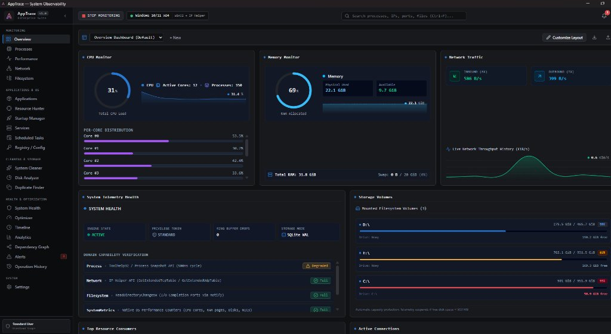
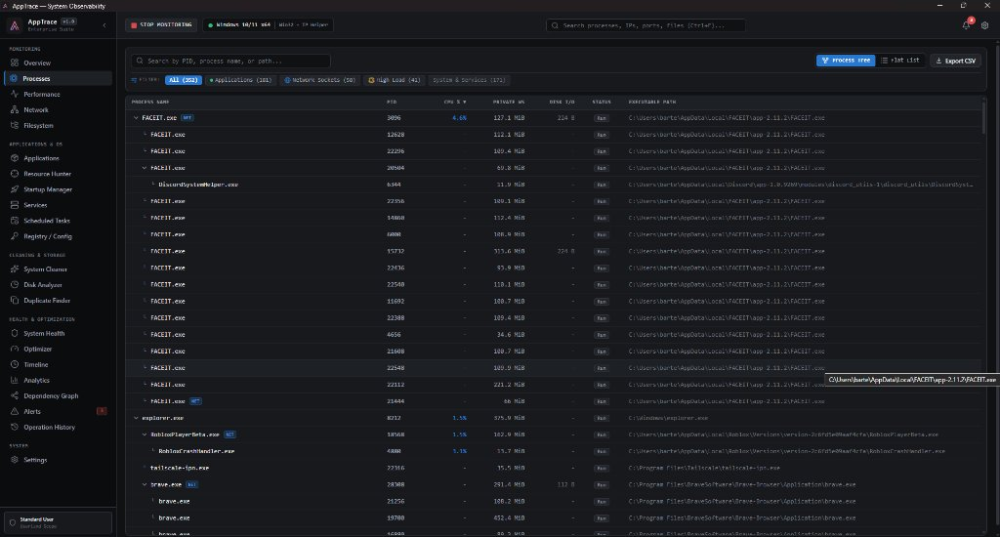
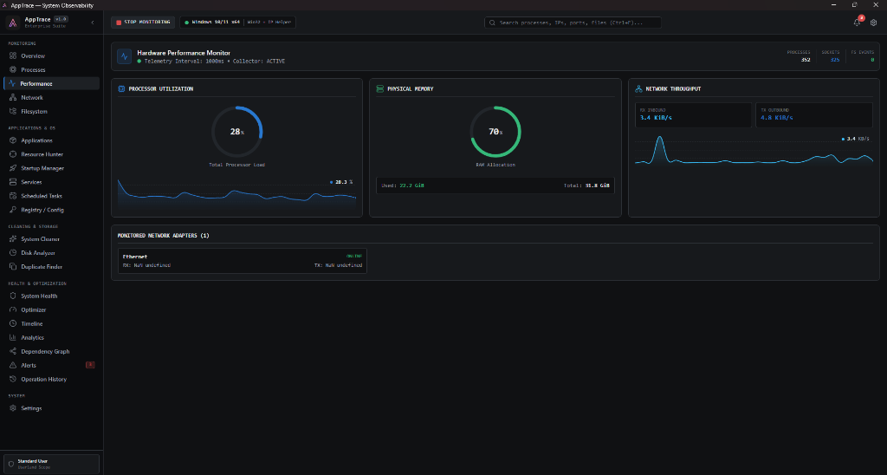
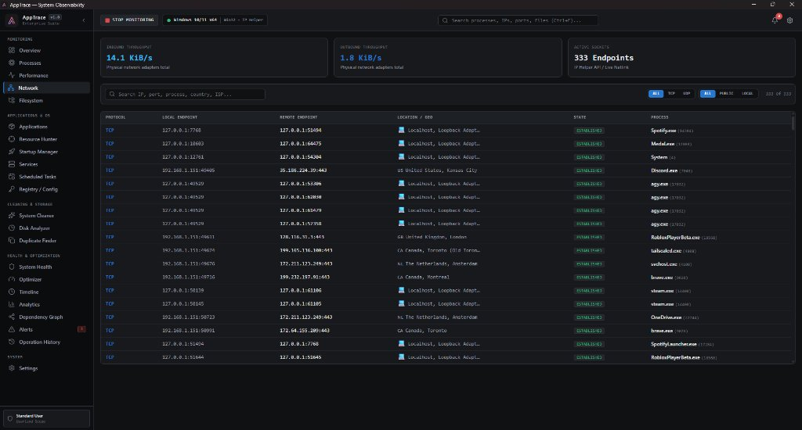
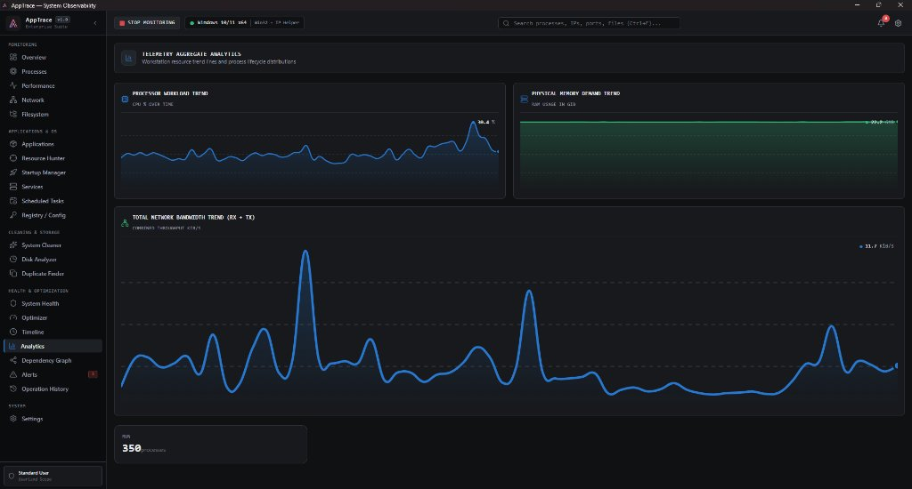
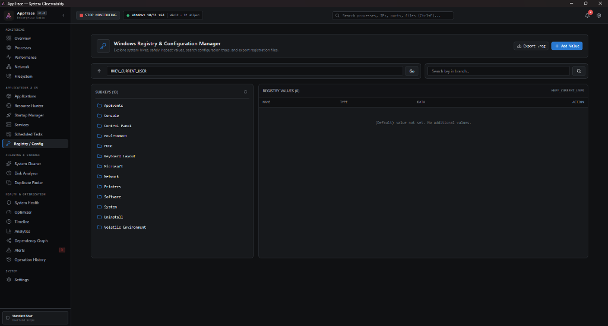
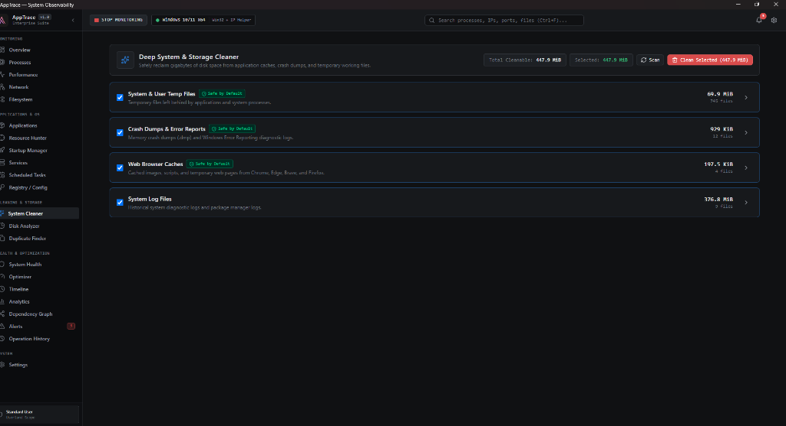
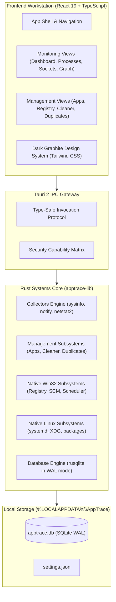

# AppTrace

<p align="center">
  
</p>

<p align="center">
  <strong>Enterprise-Grade, Local-First Desktop Observability & System Management Workstation</strong>
</p>

<p align="center">
  <a href="docs/installation/WINDOWS.md"></a>
  <a href="docs/installation/LINUX.md"></a>
  
  
  
  <a href="LICENSE"></a>
</p>

---

## 1. About AppTrace

**AppTrace** is a professional desktop system management, deep cleaning, and observability workstation built for power users, sysadmins, and software engineers. Designed with a **Dark Graphite** enterprise visual system inspired by Windows Sysinternals, AppTrace unifies low-level operating system telemetry with advanced application lifecycle management.

### Key Differentiators:
- **Local-First Architecture:** AppTrace is designed as a local-first application. Application data and operation history are stored locally in SQLite (`WAL` mode). No intentional analytics or telemetry service is documented.
- **Deep Operating System Understanding:** Correlates running processes with installed registry software, autostart run keys, background services, active network sockets, and filesystem footprints.
- **Native Precision:** Utilizes native Win32 APIs directly (`RegOpenKeyExW`, `RegEnumValueW`, `RegSetValueExW`, Win32 Service Control Manager) for sub-millisecond execution and immunity against shell injection.
- **Portable Architecture:** Operates as a completely self-contained Windows portable binary with zero installer requirements and zero runtime dev server dependencies.

---

## 2. Key Features

| Category | Implemented Modules & Capabilities |
| :--- | :--- |
| **System Observability** | Real-time CPU & per-core load, physical memory commit gauges, network RX/TX bandwidth, storage volume health, and live filesystem directory change monitoring. |
| **Process Intelligence** | Sysinternals-grade hierarchical process tree with PIDs, CPU%, Private Working Set RAM, disk I/O, status, and executable path resolution. |
| **Network & Topology** | Active TCP/UDP socket enumeration, process-to-socket attribution, local GeoIP location flags, and an interactive physics-driven Canvas 2D dependency graph. |
| **Software Management** | 64-bit, 32-bit (`Wow6432Node`), and per-user software inventory; safe uninstaller launcher; and orphaned leftover cache scanner (`%APPDATA%`, `%LOCALAPPDATA%`). |
| **Windows Internals** | Native Win32 Registry Editor (`HKCU`/`HKLM`), Windows Service Control Manager (SCM) controller with critical service lockdown, and Startup autostart manager. |
| **Storage & Cleaning** | Multi-category deep cleaner (temp files, crash dumps, WER error logs, browser caches), folder size tree analyzer, and 3-stage duplicate file finder. |
| **Health & Optimization** | Multi-factor 0–100 System Health Diagnostic Score, telemetry-backed actionable optimization recommendations, and persistent SQLite operation audit trail. |

---

## 3. Platform Support Policy

| Platform | Channel | Status | Tested Environment / Notes | Distribution Format |
| :--- | :---: | :---: | :--- | :--- |
| **Windows (x86_64)** | **Stable** | **Ready for Use** | Verified on Windows 11 Pro x64 (Build 26300). Target requirements: Windows 10 (1809+) / Windows 11 (x64) with WebView2. | Standalone Portable ZIP (`AppTrace-Windows-x64-Portable.zip`, 7.98 MB) |
| **Ubuntu / Debian (x86_64)** | **Public Beta** | **Evaluation Only** | Build instructions provided for evaluation; native Linux compilation and GUI behavior are unverified. Packaged binaries are unavailable. | Source build instructions (not certified) |

> [!NOTE]
> **Platform Testing Scope:** Windows automated test suites and smoke verification were executed on Windows 11 Pro x64 (Build 26300). Windows 10 (1809+) is supported via standard Win32/Tauri API compatibility. Linux support is in **Public Beta**: native compilation and GUI behavior have not yet been verified on a Linux build host; packaged distributions (.deb, .rpm, .AppImage) are unavailable. The Linux Beta status does not affect Windows Stable availability.

---

## 4. Download & Installation

### Windows (Stable — Portable Release):
1. **Download:** Get the latest [`AppTrace-Windows-x64-Portable.zip`](release/AppTrace-Windows-x64-Portable.zip) (7.98 MB).
2. **Verify Checksum (Optional):**
   ```powershell
   Get-FileHash -Algorithm SHA256 .\AppTrace-Windows-x64-Portable.zip
   # Expected SHA256: e35ff28dbfc926fcbcf836fde3e13415c8537be2c3f9bc19f32ed7df2df246cb
   ```
3. **Extract & Launch:** Extract the ZIP archive anywhere on your PC and double-click `AppTrace.exe`. No installation wizard or background services required.

For complete setup instructions and SmartScreen guidance, see the [Windows Installation Guide](docs/installation/WINDOWS.md).

---

## 5. Visual Observability Gallery

AppTrace features high-density, real-time diagnostic views designed for low-overhead telemetry and deep Windows system management:

| System Overview Dashboard | Process Explorer (Hierarchical Tree) |
| :---: | :---: |
| [](docs/screenshots/overview_dashboard.png) | [](docs/screenshots/process_explorer.png) |
| *Real-time CPU & per-core distribution, memory allocation gauges, network throughput history, storage status & subsystem engine health.* | *Sysinternals-grade process hierarchy with PIDs, CPU%, Private Working Set, disk I/O, status and full executable path resolution.* |

| Hardware Performance Monitor | Active Network Socket Telemetry |
| :---: | :---: |
| [](docs/screenshots/performance_monitor.png) | [](docs/screenshots/network_monitor.png) |
| *Processor utilization sparklines, RAM allocation dials, live network throughput and monitored physical network adapter interfaces.* | *Active TCP/UDP sockets, local and remote endpoints, connection states, process mapping, and GeoIP country flags.* |

| Workstation Dependency Topology | Telemetry Aggregate Analytics |
| :---: | :---: |
| [](docs/screenshots/dependency_graph.png) | [](docs/screenshots/analytics_trends.png) |
| *Interactive force-directed live physics graph mapping relations between user apps, system services, and active network connections.* | *Long-term workload trendlines, physical memory demand curves, and aggregate network bandwidth over time.* |

| Windows Registry Manager | Deep System & Storage Cleaner |
| :---: | :---: |
| [](docs/screenshots/registry_manager.png) | [](docs/screenshots/system_cleaner.png) |
| *Native Win32 registry tree browser, value editor, hex/string inspector, and key search with built-in system key safety locks.* | *Targeted multi-category cleaner for temporary files, crash dumps, Windows Error Reporting (WER), browser caches, and logs.* |

| Disk Space & Directory Size Analyzer | Real-Time Filesystem Monitor |
| :---: | :---: |
| [](docs/screenshots/disk_analyzer.png) | [](docs/screenshots/filesystem_monitor.png) |
| *Subdirectory storage allocation breakdown, hierarchical path navigator, and multi-gigabyte large file discovery engine.* | *Low-overhead filesystem event monitor tracking directory change notifications (file create, modify, delete timestamps).* |

---

## 6. Documentation Portal

AppTrace includes organized, professional documentation for users, administrators, and developers:

### User & Installation Guides:
- **[Windows Installation Guide (Stable)](docs/installation/WINDOWS.md):** Step-by-step setup, SHA-256 validation, and SmartScreen guidance.
- **[Linux Installation Guide (Public Beta)](docs/installation/LINUX.md):** Distribution requirements, system libraries, and building from source.
- **[First Start Guide](docs/guides/FIRST-START.md):** Walkthrough of the UI, widget layout, and safe management workflows.
- **[Feature Guide](docs/guides/FEATURES.md):** Detailed technical specifications of all 12 management and monitoring modules.
- **[Uninstallation Guide](docs/guides/UNINSTALLATION.md):** Safe removal of the portable application and local SQLite user data.
- **[Troubleshooting Guide](docs/installation/TROUBLESHOOTING.md):** Solutions for startup issues, permissions, and database locks.

### Developer & Technical References:
- **[Building from Source](docs/development/BUILDING.md):** Toolchains, prerequisites, and production build instructions.
- **[Contributing Guide](docs/development/CONTRIBUTING.md):** Code standards, design system rules, and verification requirements.
- **[Technical Architecture](docs/ARCHITECTURE.md):** Deep technical dive into collectors, IPC gateway, and SQLite WAL storage.
- **[Security Policy](SECURITY.md):** Security boundaries, path traversal defenses, and vulnerability disclosure.
- **[Independent Verification Report](docs/INDEPENDENT_VERIFICATION_REPORT.md):** Independent release gate evaluation and audit evidence.
- **[Complete Documentation Index](docs/README.md):** Central navigation portal for all project documentation.

---

## 7. Technology Stack



- **Runtime Framework:** [Tauri 2](https://tauri.app/) (embedded native WebView2 on Windows, WebKit2GTK on Linux).
- **Systems Core:** [Rust](https://www.rust-lang.org/) (2024 edition, native Win32 APIs via `windows-sys`).
- **Frontend Architecture:** [React 19](https://react.dev/), [TypeScript](https://www.typescriptlang.org/), [Tailwind CSS](https://tailwindcss.com/).
- **Data Persistence:** [SQLite](https://www.sqlite.org/) in `WAL` mode via [rusqlite](https://github.com/rusqlite/rusqlite).

---

## 8. Privacy & Defensive Security

AppTrace enforces strict safety boundaries to ensure destructive operations cannot damage the host operating system:

1. **Local-First & No External Telemetry SDKs:** AppTrace is designed as a local-first application. Application data and operation history are stored locally. No intentional analytics or telemetry service is documented in the application source code. (Third-party runtime components, such as Microsoft Edge WebView2, may perform standard OS-level platform queries outside application control.)
2. **System Root Guards:** Destructive operations strictly block system directories (`C:\Windows`, `System32`, `SysWOW64`, `Program Files`, `/etc`, `/bin`, `/boot`, `/usr`).
3. **Path Traversal Defenses:** All paths are normalized, canonicalized, and checked for `..` tokens before deletion.
4. **Symlink Rejection:** Deletion engines inspect `fs::symlink_metadata` and refuse to unlink symlinks to prevent redirection attacks.
5. **Critical Service Locks:** Essential OS services (`rpcss`, `lsass`, `csrss`, `winlogon`, `cryptsvc`, `eventlog`) cannot be stopped or disabled.
6. **Decoupled Operation Logging:** Operating system command results remain decoupled from database persistence. A database logging failure will never falsely report that an OS action failed.

---

## 9. Development Status

| Channel | Target Architecture | Current Version | Status |
| :--- | :--- | :---: | :---: |
| **Windows** | x86_64 (Intel / AMD 64-bit) | **v1.1.1** | **Stable — Verified on Windows 11 Pro (Build 26300)** |
| **Linux** | x86_64 (Intel / AMD 64-bit) | **v1.1.1** | **Public Beta — Evaluation Only (Unverified Native Build)** |

- Automated verification test suite (`test_runner`): **11/11 Suites Passed**.
- Standalone portable smoke verification: **Passed (PID 33252, ~69 MB RAM)**.
- Cryptographic release manifests: Verified in [`release/checksums/SHA256SUMS.txt`](release/checksums/SHA256SUMS.txt).

---

## 10. Contributing

Contributions to AppTrace are welcome!
1. Review the [Contributing Guide](docs/development/CONTRIBUTING.md) and [Building Guide](docs/development/BUILDING.md).
2. Adhere to Rust formatting (`cargo fmt`) and TypeScript typing (`npx tsc -b`).
3. Ensure all tests in `src-tauri/src/bin/test_runner.rs` pass before opening a Pull Request.
4. Preserve the strict **Dark Graphite** design system and defensive security boundaries.

---

## 11. License

This project is licensed under the **MIT License**. See the [LICENSE](LICENSE) file for details.
