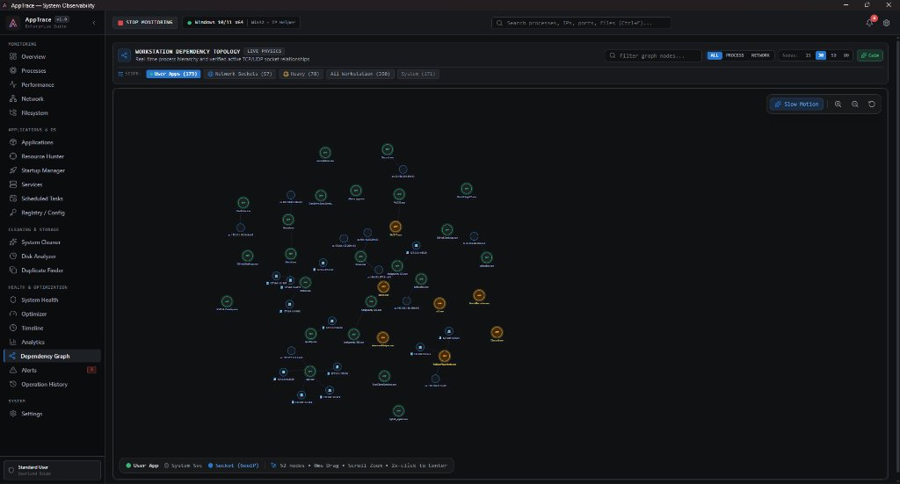
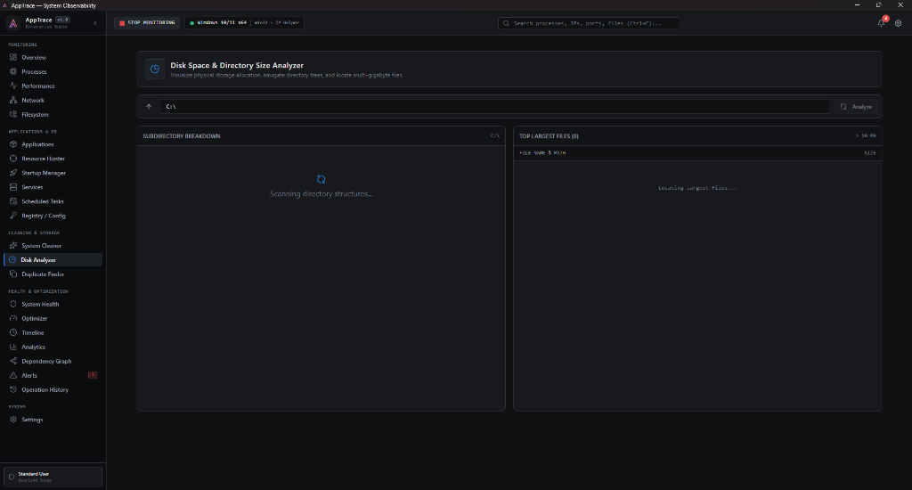
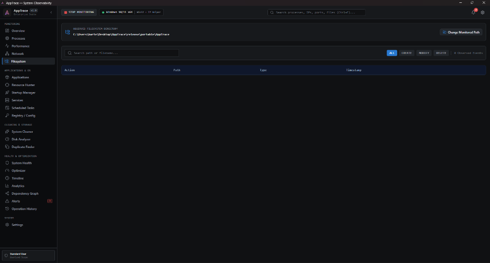
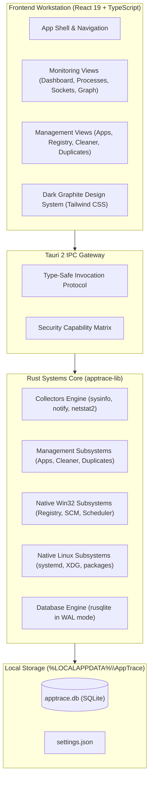

# AppTrace

<p align="center">
  
</p>

<p align="center">
  <strong>Enterprise-Grade, Local-First Desktop Observability & System Management Workstation</strong>
</p>

<p align="center">
  
  
  
  
  
  
</p>

---

## 1. Overview

**AppTrace** is a professional desktop system management, deep cleaning, and observability application built for power users, sysadmins, and software engineers. Designed with a **Dark Graphite** enterprise visual design system inspired by Windows Sysinternals Process Explorer, AppTrace unifies low-level system metrics with advanced application lifecycle management.

Unlike conventional administration tools or generic cleaning utilities:
- **100% Local-First & Private:** All telemetry, metrics, application records, and history are stored locally in SQLite (`WAL` mode). There are zero telemetry beacons, zero analytical tracking scripts, and zero cloud dependencies.
- **Deep Operating System Understanding:** Correlates running processes with installed registry applications, startup run keys, scheduled tasks, network sockets, and filesystem footprints.
- **Native Precision:** Utilizes native Win32 APIs directly (`RegOpenKeyExW`, `RegEnumValueW`, `RegSetValueExW`, Win32 Service Control Manager) for sub-millisecond execution and immunity against shell command injection.
- **Portable Architecture:** Operates as a completely self-contained Windows portable binary with zero installer requirements and zero runtime dev server dependencies.

---

## 2. Visual Design System

AppTrace is styled in a strictly neutral **Dark Graphite** enterprise workstation palette (`#101113` background, `#0B0C0E` sidebar, `#17191C` panel surfaces, `#1D2024` elevated cards, `#30343A` borders, with `#2878D0` diagnostic blue accents).

### User Interface Layout

```
+-----------------------------------------------------------------------------------------+
| [Logo] AppTrace — System Observability & Management Suite             [Live] [Settings] |
+-----------------------+-----------------------------------------------------------------+
| MONITORING            | DASHBOARD / ACTIVE VIEW                                         |
|  * Overview           | +--------------------+ +--------------------+ +---------------+ |
|  * Processes          | | CPU: 12.4% (8c/16t)| | RAM: 14.2 / 31.8 GB| | Storage: 68%   | |
|  * Performance        | +--------------------+ +--------------------+ +---------------+ |
|  * Network            |                                                                 |
|  * Filesystem         | PROCESS EXPLORER / APPLICATION MANAGEMENT TABLE                 |
|                       | [ Search resources... ] [ Filter: All | User | Machine ]        |
| APPLICATIONS & OS     | +-------------------------------------------------------------+ |
|  * Applications       | | Name            | Publisher      | Version | Size   | State | |
|  * Resource Hunter    | |-----------------+----------------+---------+--------+-------| |
|  * Startup Manager    | | Visual Studio   | Microsoft Corp | 17.12.0 | 4.2 GB | Idle  | |
|  * Services           | | Docker Desktop  | Docker Inc     | 4.35.0  | 1.8 GB | Run   | |
|  * Scheduled Tasks    | +-------------------------------------------------------------+ |
|  * Registry / Config  |                                                                 |
|                       | CORRELATED RELATIONSHIPS PANEL                                  |
| STORAGE & CLEANING    | * Executable: C:\Program Files\Docker\Docker\Docker Desktop.exe |
|  * System Cleaner     | * Running PIDs: [14208, 18944]                                  |
|  * Disk Analyzer      | * Run Key: HKCU\SOFTWARE\Microsoft\Windows\CurrentVersion\Run   |
|  * Duplicate Finder   | * Storage: %LOCALAPPDATA%\Docker (1.2 GB cache detected)        |
+-----------------------+-----------------------------------------------------------------+
```

### Application Screenshots & Observability Gallery

AppTrace features high-density, real-time diagnostic views designed for low-overhead telemetry and deep Windows system management.

#### 1. System Observability & Process Intelligence

| System Overview Dashboard | Process Explorer (Hierarchical Tree) |
| :---: | :---: |
| [](docs/screenshots/overview_dashboard.png) | [](docs/screenshots/process_explorer.png) |
| *Real-time CPU & per-core distribution, memory allocation gauges, network throughput history, storage status & subsystem engine health.* | *Sysinternals-grade process hierarchy with PIDs, CPU%, Private Working Set, disk I/O, status and full executable path resolution.* |

| Hardware Performance Monitor | Active Network Socket Telemetry |
| :---: | :---: |
| [](docs/screenshots/performance_monitor.png) | [](docs/screenshots/network_monitor.png) |
| *Processor utilization sparklines, RAM allocation dials, live network throughput and monitored physical network adapter interfaces.* | *Active TCP/UDP sockets, local and remote endpoints, connection states, process mapping, and GeoIP country flags.* |

| Workstation Dependency Topology | Telemetry Aggregate Analytics |
| :---: | :---: |
| [](docs/screenshots/dependency_graph.png) | [](docs/screenshots/analytics_trends.png) |
| *Interactive force-directed live physics graph mapping relations between user apps, system services, and active network connections.* | *Long-term workload trendlines, physical memory demand curves, and aggregate network bandwidth over time.* |

#### 2. System Management, Storage Cleaning & Windows Internals

| Windows Registry Manager | Deep System & Storage Cleaner |
| :---: | :---: |
| [](docs/screenshots/registry_manager.png) | [](docs/screenshots/system_cleaner.png) |
| *Native Win32 registry tree browser, value editor, hex/string inspector, and key search with built-in system key safety locks.* | *Targeted multi-category cleaner for temporary files, crash dumps, Windows Error Reporting (WER), browser caches, and logs.* |

| Disk Space & Directory Size Analyzer | Real-Time Filesystem Monitor |
| :---: | :---: |
| [](docs/screenshots/disk_analyzer.png) | [](docs/screenshots/filesystem_monitor.png) |
| *Subdirectory storage allocation breakdown, hierarchical path navigator, and multi-gigabyte large file discovery engine.* | *Low-overhead filesystem event monitor tracking directory change notifications (file create, modify, delete timestamps).* |

---

## 3. Comprehensive Feature Matrix

| Module | Purpose & Core Capabilities | Platform Support | Security Guard |
| :--- | :--- | :---: | :--- |
| **System Observability** | Real-time CPU, RAM, disk I/O, process tree hierarchy, network socket table, and filesystem event timeline. | Windows & Linux | Read-only kernel queries |
| **Installed Applications** | Scans 64-bit, 32-bit (`Wow6432Node`), and per-user (`HKCU`) registry roots. Correlates running processes with install paths. | Windows & Linux (`dpkg`/`rpm`/`flatpak`) | Read-only registry & package enumeration |
| **Advanced Uninstaller** | Parses uninstall command strings safely without shell injection. Supports quiet execution (`QuietUninstallString`). | Windows & Linux | Rejects unvalidated command strings |
| **Leftover Scanner** | Heuristic detection of orphaned `%APPDATA%`, `%LOCALAPPDATA%`, `%PROGRAMDATA%`, and publisher registry trees. | Windows & Linux | Hard block on OS roots (`C:\Windows`, `System32`) |
| **Startup Manager** | Discovers registry Run keys (`HKCU`/`HKLM`) and Startup folders. Enables safe toggling via `AppTrace_Disabled_` prefixes. | Windows & Linux (XDG autostart) | Preserves original command string |
| **Services Manager** | Queries Windows Service Control Manager (SCM). Displays status, startup types (Automatic/Manual/Disabled), and allows starting/stopping. | Windows & Linux (`systemctl`) | **Hard lock** on critical services (`rpcss`, `lsass`, `csrss`, etc.) |
| **Scheduled Tasks** | Windows Task Scheduler parser with `schtasks` fallback. Displays triggers, actions, authors, and states. | Windows & Linux (`systemd-timers`/`cron`) | Execution flags validated |
| **Win32 Registry Manager** | Native Win32 API tree browser, value editor (`REG_SZ`, `REG_DWORD`, `REG_QWORD`, `REG_BINARY`, `REG_MULTI_SZ`), search, and `.reg` exporter. | Windows (Native Win32) | Hard block on `SYSTEM\CurrentControlSet`, `SAM`, `SECURITY` |
| **Deep Cleaner** | Multi-category scanner for System Temp, Crash Dumps (`.dmp`), WER error reports, browser caches, and system logs. | Windows & Linux | Prevents symlink traversal; preview before deletion |
| **Disk Analyzer** | Recursive multi-depth folder usage aggregation, breadcrumb navigation, and bounded largest files detector. | Windows & Linux | Bypasses symlink loops; memory-bounded pruning |
| **Duplicate Finder** | 3-stage duplicate detection (File Size $\rightarrow$ 4 KB Header Hash $\rightarrow$ Full 128-bit streaming hash). Zero false positives. | Windows & Linux | Requires full-content cryptographic match |
| **System Health Center** | Multi-factor 0–100 health diagnostic score evaluating storage headroom, memory commitment, CPU runaways, and service states. | Windows & Linux | Uses real telemetry; never invents fake scores |
| **System Optimizer** | Actionable recommendations backed by measured system evidence with classified risk levels. | Windows & Linux | Previews impact; no automatic silent modifications |
| **Resource Hunter** | Universal software search cross-indexing installed apps, active processes, filesystem files, registry keys, and services. | Windows & Linux | Read-only correlation queries |
| **Operation History** | Persistent SQLite audit log recording every uninstallation, cleaning action, startup toggle, and service control event. | Windows & Linux | ACID transaction logging in SQLite |

---

## 4. Platform Compatibility

| Capability | Windows 10 / 11 (x86_64) | Linux (x86_64 / arm64) |
| :--- | :---: | :---: |
| **Core Telemetry (CPU, RAM, Sockets)** | **Supported (Verified on Host)** | **Supported (sysinfo / netstat2)** |
| **Application Inventory** | **Supported (64-bit, 32-bit, HKCU)** | **Supported (`dpkg`, `rpm`, `flatpak`)** |
| **Uninstaller & Leftover Scanner** | **Supported (Verified on Host)** | **Supported (Package remove + config)** |
| **Win32 Registry Manager** | **Supported (Native Win32 APIs)** | *Not Applicable (Windows Architecture)* |
| **Linux Configuration Browser** | *Not Applicable* | **Supported (`/etc` structured browser)** |
| **Startup Management** | **Supported (Registry & Startup Menu)** | **Supported (XDG autostart & user units)** |
| **Services Control** | **Supported (Win32 SCM & net.exe)** | **Supported (`systemctl` integration)** |
| **Scheduled Tasks** | **Supported (Task Scheduler)** | **Supported (`systemd.timer` / `crontab`)** |
| **Deep Cleaner & Disk Analyzer** | **Supported (Verified on Host)** | **Supported (Native POSIX traversal)** |
| **Duplicate Detection** | **Supported (Verified on Host)** | **Supported (Pure Rust 128-bit engine)** |
| **Standalone Portable Release** | **Supported (`AppTrace.exe`, ~26 MB)** | **Supported (Standalone AppImage/Binary)** |

---

## 5. Security & Safety Architecture

AppTrace enforces strict safety boundaries to ensure destructive operations cannot damage the host operating system:

```
+-----------------------------------------------------------------------------------+
|                            USER INITIATED ACTION                                  |
|         (e.g., Clean Temp, Delete Leftovers, Toggle Startup, Edit Registry)       |
+-----------------------------------------------------------------------------------+
                                          |
                                          v
+-----------------------------------------------------------------------------------+
|                          APITRACE SAFETY SHIELD LAYER                             |
+-----------------------------------------------------------------------------------+
| [Path Canonicalization]    Rejects relative traversal (".."), symlinks, roots.     |
| [OS Root Blacklist]        Absolute block: C:\Windows, System32, Program Files.   |
| [Profile Protection]       Absolute block: C:\Users\<name>, Documents, Desktop.   |
| [Registry Hive Lock]       Blocks: HKLM, HKCU roots, SAM, SECURITY, CurrentControlSet.|
| [Critical Service Lock]    Blocks stopping: rpcss, samss, lsass, csrss, winlogon. |
+-----------------------------------------------------------------------------------+
                                          |
                     [ SAFETY VALIDATION PASSED? ]
                               /         \
                             YES          NO
                             /              \
                            v                v
            [ EXECUTE NATIVE OPERATION ]     [ OPERATION ABORTED ]
            * Native Win32 API               * Returns specific safety error
            * Audit log recorded in SQLite   * Zero changes written to disk
```

### Key Safeguards:
1. **Never Silently Destructive:** All cleaning and uninstallation routines require explicit user preview and confirmation.
2. **Path Traversal Protection:** Every path submitted to `is_safe_directory` is normalized, inspected for `..` traversal tokens, and validated against canonical filesystem targets.
3. **No Shell Concatenation:** Uninstallation commands are tokenized into explicit executable and argument vectors, preventing shell injection vulnerabilities.
4. **Least Privilege Operation:** AppTrace runs as a standard user process. When administrative operations are required (e.g. system service control or HKLM writes), clear elevation prompts are handled through documented Windows UAC / SCM channels.

---

## 6. Architecture & Technology Stack



---

## 7. Installation & Portable Execution

### Portable Windows Build (Zero Installation)
AppTrace is distributed as an enterprise-grade portable binary:

```
release/portable/AppTrace/AppTrace.exe
```

- **Zero Installer Needed:** Extract or copy `AppTrace.exe` anywhere (Desktop, USB drive, network share) and double-click to run.
- **Embedded Frontend:** The complete React/TypeScript user interface is embedded directly inside the 26 MB executable. It does **not** connect to `localhost:5173` or require an active Node.js server.
- **Standard Runtime:** Requires Windows 10 (Build 19041+) or Windows 11 with the standard Microsoft Edge WebView2 runtime (pre-installed on all modern Windows installations).

### Data Storage Paths
AppTrace stores all operational state and telemetry strictly in standard local paths:
- **Windows:** `%LOCALAPPDATA%\AppTrace\`
  - Database: `%LOCALAPPDATA%\AppTrace\apptrace.db`
  - Settings: `%LOCALAPPDATA%\AppTrace\settings.json`
- **Linux:** `~/.local/share/apptrace/`

---

## 8. Building from Source

### Prerequisites
- **Node.js:** v18.0.0 or higher (v20+ recommended)
- **Rust Toolchain:** v1.85.0+ (stable channel)
- **C++ Build Tools:** Visual Studio Build Tools (C++ x86/x64 compiler) on Windows, or `build-essential` on Linux.
- **Tauri CLI:** Installed locally via `package.json` devDependencies.

### Step-by-Step Build Commands

```bash
# 1. Clone the repository
git clone https://github.com/your-username/AppTrace.git
cd AppTrace

# 2. Install frontend dependencies
npm install

# 3. Compile and verify TypeScript frontend
npm run build

# 4. Run Rust systems core verification
cargo check --manifest-path src-tauri/Cargo.toml

# 5. Execute comprehensive automated verification suite
cargo run --manifest-path src-tauri/Cargo.toml --bin test_runner

# 6. Build production portable standalone executable
npm run tauri -- build --no-bundle
```

On Windows, you can also execute the automated verification and packaging script:
```powershell
powershell.exe -ExecutionPolicy Bypass -File scripts\build-windows.ps1
```

---

## 9. Automated Testing & Verification

AppTrace includes an automated integration test runner (`src-tauri/src/bin/test_runner.rs`) that validates real operating system interactions against disposable, isolated fixtures:

```
============================================================
    APPTRACE COMPREHENSIVE FUNCTIONAL VERIFICATION SUITE    
============================================================
[TEST 1/11] Database Subsystem & SCHEMA_V2 Migrations... PASSED
[TEST 2/11] Uninstaller Safety Rules & Command Parsing... PASSED
[TEST 3/11] Disk Analyzer & Largest Files Detection... PASSED
[TEST 4/11] 3-Stage Duplicate Finder (Header Collision Check)... PASSED
[TEST 5/11] Deep Cleaner Categories & Safety Flags... PASSED
[TEST 6/11] Native Win32 Registry Manager Operations... PASSED
[TEST 7/11] Applications Discovery & Correlation Engine... PASSED (88 installed applications discovered)
[TEST 8/11] Startup Manager Discovery... PASSED (14 startup entries discovered)
[TEST 9/11] Services Manager & Critical Service Lockdown... PASSED (200 services checked, critical services protected)
[TEST 10/11] System Health Score & Telemetry-Backed Optimizer... PASSED (Telemetry-scored health index computed)
[TEST 11/11] Universal Software & Resource Hunter... PASSED (Cross-correlated search active)

============================================================
  ALL COMPREHENSIVE VERIFICATION TESTS PASSED SUCCESSFULLY! 
============================================================
```

To run smoke-testing on the portable release binary:
```powershell
powershell.exe -ExecutionPolicy Bypass -File scripts\verify-release.ps1
```

---

## 10. Troubleshooting

| Issue | Root Cause | Solution |
| :--- | :--- | :--- |
| **`ERR_CONNECTION_REFUSED` on startup** | You launched `src-tauri\target\debug\apptrace.exe` without running `npm run tauri dev`. | Launch the release portable binary at `release\portable\AppTrace\AppTrace.exe`. Debug builds connect to Vite at `localhost:5173`, whereas release builds embed all assets internally. |
| **Permission Denied on Registry / Service Change** | Windows User Account Control restricts standard user tokens from writing to system hives (`HKLM`) or controlling drivers. | Right-click `AppTrace.exe` and select **Run as administrator** if modifying machine-wide services or system configuration. |
| **Missing WebView2 Runtime** | System lacks Microsoft Edge WebView2 runtime. | Modern Windows 10/11 includes this by default. On Windows Server or N-editions, install the evergreen WebView2 runtime from Microsoft. |
| **File Locked during Build / Copy** | An existing instance of `AppTrace.exe` is currently running. | Run `Get-Process AppTrace | Stop-Process` or run `scripts\build-windows.ps1` which automatically closes running instances before copying. |

---

## 11. Contributing

Contributions to AppTrace are welcome!
1. Fork the repository and create a feature branch (`git checkout -b feature/system-enhancement`).
2. Adhere to Rust formatting (`cargo fmt`) and TypeScript linting (`npx oxlint`).
3. Ensure all tests in `src-tauri/src/bin/test_runner.rs` pass before opening a pull request.
4. Maintain the strict **Dark Graphite** design system and safety isolation boundaries.

---

## 12. License & Acknowledgements

This project is licensed under the **MIT License**.

AppTrace is powered by exceptional open-source technologies:
- [Tauri](https://tauri.app/) — Lightweight desktop application framework
- [Rust](https://www.rust-lang.org/) — High-performance systems programming
- [React](https://react.dev/) — User interface library
- [Tailwind CSS](https://tailwindcss.com/) — Utility-first CSS framework
- [Lucide](https://lucide.dev/) — Enterprise system iconography
- [SQLite / rusqlite](https://github.com/rusqlite/rusqlite) — Reliable local persistence
