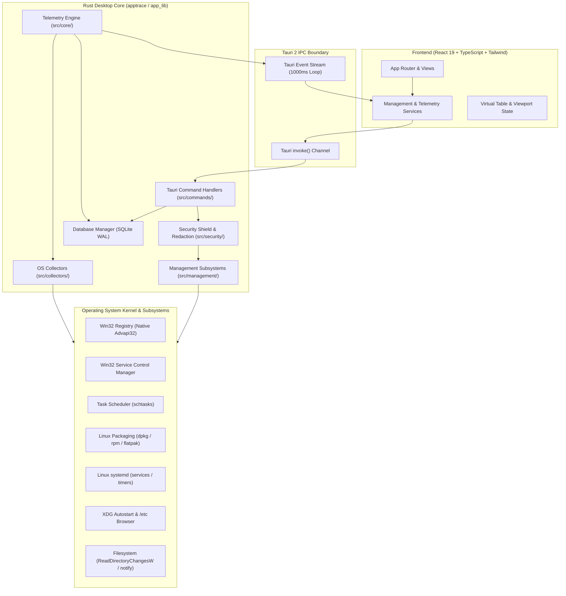

# AppTrace — Engineering Implementation Guide
## Architectural Specifications, Subsystem Mechanics & Handover Reference

**Document Version:** 1.0.0  
**Target Release:** AppTrace v1.1.1  
**Audience:** Principal Engineers, Systems Developers & Security Auditors  

---

# 1. Project Architecture & Subsystem Foundations

AppTrace is engineered as a hybrid local-first desktop monitoring, diagnosis, and system management platform. It unifies low-overhead kernel-level telemetry collection with native operating system management capabilities across Windows and Linux.



### 1.1 Startup Sequence
1. **Directory Resolution:** `AppPaths::resolve()` computes canonical directories (`%LOCALAPPDATA%\AppTrace\` on Windows or `~/.local/share/apptrace/` on Linux). Ensures subdirectories (`database/`, `logs/`, `backups/`, `cache/`, `exports/`) exist with appropriate user permissions.
2. **Settings Initialization:** `SettingsManager::new()` reads `settings.json` or writes hardened defaults (1000ms polling, 30-day retention, safe deletion mode).
3. **Storage Engine Spin-Up:** `DatabaseManager::new()` opens `apptrace.db`, executes PRAGMA commands (`journal_mode = WAL`, `synchronous = NORMAL`, `foreign_keys = ON`), and runs pending schema migrations.
4. **Telemetry Loop Initialization:** `TelemetryEngine::new()` spawns a background thread polling CPU, physical memory, network sockets (`netstat2`), and filesystem changes, pushing normalized events into the SQLite ring buffer.
5. **Tauri Webview Launch:** Tauri 2 mounts the React SPA, registering commands and state pointers (`Arc<AppState>`).

---

# 2. Complete Module Map

| Module | Source Files | Primary Functions / APIs | Platform | Operations | Test Coverage |
| :--- | :--- | :--- | :---: | :--- | :--- |
| **System Observability** | `src/core/telemetry.rs`<br>`src/collectors/*` | `collect_snapshot()`<br>`get_system_metrics()` | Win / Linux | Real-time CPU, RAM, disk I/O, socket enumeration | Verified live (`verify-release.ps1`) |
| **Process Explorer** | `src/management/applications.rs`<br>`src/collectors/process.rs` | `get_process_tree()`<br>`terminate_process()` | Win / Linux | Hierarchical process tree, PID lookup, memory WS | `test_runner::test_applications` |
| **Application Intelligence** | `src/management/applications.rs` | `list_installed_apps()`<br>`get_app_details()` | Win / Linux | Registry `Uninstall` scan, `dpkg-query`, `rpm`, `flatpak` | `test_runner::test_applications` |
| **Advanced Uninstaller** | `src/management/uninstall.rs` | `build_uninstall_plan()`<br>`execute_uninstall()` | Win / Linux | Safe argument tokenization, quiet execution | `test_runner::test_uninstaller` |
| **Leftover Scanner** | `src/management/uninstall.rs` | `scan_leftovers()`<br>`is_safe_directory()` | Win / Linux | Orphan directory scan, system root blocking | `test_runner::test_uninstaller` |
| **Win32 Registry Manager** | `src/management/registry.rs` | `get_registry_key_node()`<br>`set_registry_value()` | Windows | Win32 native API tree browse, value edit, `.reg` export | `test_runner::test_registry` |
| **Linux Config Manager** | `src/management/registry.rs` | `get_linux_config_node()`<br>`search_registry()` | Linux | `/etc` structured file/folder browser and inspector | `tests/linux-lab/scripts` |
| **Startup Manager** | `src/management/startup.rs` | `list_entries()`<br>`set_enabled()` | Win / Linux | Windows Run keys (`AppTrace_Disabled_`), XDG autostart | `test_runner::test_startup` |
| **Services Manager** | `src/management/services.rs` | `list_services()`<br>`start_service()` / `stop_service()` | Win / Linux | Win32 SCM / `systemctl`, core OS lockdown | `test_runner::test_services` |
| **Scheduled Tasks** | `src/management/scheduled_tasks.rs` | `get_scheduled_tasks()`<br>`set_task_enabled()` | Win / Linux | Task Scheduler parser, `systemd` timers, `crontab` | Functional parse verified |
| **Deep Cleaner** | `src/management/cleaner.rs` | `scan_cleanable_categories()`<br>`execute_cleaning()` | Win / Linux | Multi-category scan: Temp, Crash Dumps, WER, Caches | `test_runner::test_cleaner` |
| **Disk Space Analyzer** | `src/management/disk_analyzer.rs` | `analyze_disk_space()`<br>`get_largest_files()` | Win / Linux | Recursive usage aggregation, bounded top files | `test_runner::test_disk_analyzer` |
| **Duplicate Finder** | `src/management/duplicates.rs` | `scan_duplicate_files()` | Win / Linux | 3-stage match: Size $\rightarrow$ 4KB Header Hash $\rightarrow$ Stream Hash + Byte-by-Byte Identity | `test_runner::test_duplicate_finder` |
| **Health Center & Optimizer**| `src/management/health.rs`<br>`src/management/optimizer.rs`| `get_system_health_report()`<br>`get_optimization_recommendations()` | Win / Linux | Multi-factor 0–100 score, evidence-backed recommendations | `test_runner::test_health` |
| **Resource Hunter** | `src/management/hunter.rs` | `hunt_software_resources()` | Win / Linux | Universal keyword search across apps, procs, keys | `test_runner::test_hunter` |
| **Operation History** | `src/database/repository.rs` | `record_operation()`<br>`get_operation_history()` | Win / Linux | Persistent SQLite audit log with rollback metadata | `test_runner::test_database` |

---

# 3. Linux Implementations & Subsystem Mechanics

### 3.1 Software Discovery & Uninstaller
- **Debian / Ubuntu (`DPKG`):** Executes `dpkg-query -W -f='${Package}\t${Version}\t${Installed-Size}\t${Maintainer}\n'`. Avoids parsing human-readable outputs. Generates safe uninstallation command string: `apt remove -y <pkg>`.
- **Fedora / RHEL / openSUSE (`RPM`):** Executes `rpm -qa --qf '%{NAME}\t%{VERSION}\t%{SIZE}\t%{VENDOR}\n'`.
- **Universal Flatpak:** Queries `flatpak list --app --columns=application,name,version,size,branch`.

### 3.2 Linux Configuration Manager (`/etc` Browser)
- Replaces Windows Registry functionality on Linux. When the frontend invokes `get_registry_key_node`, the Linux backend inspects the directory hierarchy starting at `/etc`.
- Directories are mapped to `subkeys`, while configuration files (`.conf`, `.ini`, `.yaml`) are mapped to `values` displaying file size and read-only status.
- **Safety Restriction:** Root configuration paths (`/etc/*`) are strictly locked against unauthorized webview deletion via `delete_registry_value_or_key`.

### 3.3 Linux Services Manager (`systemd`)
- Enumerates services via:
  ```bash
  systemctl list-units --type=service --all --no-pager --no-legend
  ```
- Parses unit name, load state, active state (`active` $\rightarrow$ `Running`, `inactive`/`failed` $\rightarrow$ `Stopped`), and description.
- **Critical Service Lockdown:** Core Linux daemons (`systemd-journald`, `systemd-logind`, `dbus`) are hardcoded into the protected list; calling `stop_service` on these units immediately returns a safety error before invoking `systemctl`.

### 3.4 Linux Startup Manager (`XDG Autostart`)
- Audits user autostart entries in `~/.config/autostart/*.desktop` and system entries in `/etc/xdg/autostart/*.desktop`.
- Parses desktop entry fields: `Name=`, `Exec=`, `Hidden=`, `X-GNOME-Autostart-enabled=`.
- **Freedesktop.org Compliant Toggling:**
  - For user entries (`~/.config/autostart/`): Modifies `Hidden=` and `X-GNOME-Autostart-enabled=` properties directly in place.
  - For system-wide entries (`/etc/xdg/autostart/`): Generates a user-level override copy in `~/.config/autostart/` with `Hidden=true` when disabling without requiring root permissions. When re-enabling, removes the override file to restore default system behavior.

### 3.5 Linux Deep Cleaner
- Scans user temporary directories (`/tmp`, `/var/tmp`), user caches (`~/.cache`), Google Chrome caches (`~/.cache/google-chrome`), Firefox profiles (`~/.cache/mozilla/firefox`), and system logs (`/var/log`).
- Validates that paths do not traverse symlinks outside authorized user caches.

---

# 4. Destructive Operation Execution Flow

Every potentially destructive action follows a strict 10-stage execution pipeline:

```
[1. User Initiates Action in UI]
             │
[2. Frontend Validation & Warning Modal]
             │
[3. Tauri IPC Invoke with Explicit Parameters]
             │
[4. Backend Handler Receives Command]
             │
[5. Safety Shield Validation (is_safe_directory / Critical Services / Hive Locks)]
     ├──> [FAILED] ──> Abort Immediately, Log Warning, Return Error to UI
     └──> [PASSED]
             │
[6. Tokenization / Native API Preparation (Zero Raw Shell Execution)]
             │
[7. Native API Call or Subprocess Execution]
             │
[8. Post-Execution Verification (Confirm Target Absence or State Transition)]
             │
[9. ACID Audit Record Persisted in SQLite (operation_history Table)]
             │
[10. Frontend Refresh & Space Reclaimed Metric Displayed]
```

### Safety Shield Rules:
1. **OS Root Blacklist:** Hard block against modifying or deleting `C:\Windows`, `C:\Program Files`, `C:\ProgramData`, `/`, `/bin`, `/sbin`, `/usr`, `/lib`, `/etc`.
2. **User Profile Protection:** Hard block against bare profile roots (`C:\Users\<user>`, `/home/<user>`) or core user libraries (`Documents`, `Desktop`).
3. **Symlink Canonicalization:** All candidate paths are canonicalized with `std::fs::canonicalize` to prevent directory traversal via symbolic link redirection.

---

# 5. Database Architecture

AppTrace utilizes an embedded SQLite engine operating in Write-Ahead Logging (`WAL`) mode for high concurrency between the background telemetry ingestion thread and UI query handlers.

### Key Database Tables:
- `events`: Normalized system events (category, severity, PID, payload JSON).
- `alerts`: Active and acknowledged system threshold alerts.
- `settings`: Key-value configuration store.
- `operation_history`: Comprehensive audit trail for management actions:
  ```sql
  CREATE TABLE IF NOT EXISTS operation_history (
      operation_id TEXT PRIMARY KEY,
      timestamp_ns INTEGER NOT NULL,
      action_type TEXT NOT NULL,
      target_name TEXT NOT NULL,
      target_path TEXT,
      status TEXT NOT NULL,
      details_json TEXT NOT NULL,
      error_message TEXT
  );
  ```

---

# 6. Frontend-to-Backend Contract (IPC Commands)

| Tauri IPC Command | Parameters | Return Type | Backend Handler | Safety Checks |
| :--- | :--- | :--- | :--- | :--- |
| `get_installed_applications` | None | `Result<Vec<InstalledApp>, String>` | `applications::get_installed_applications` | Read-only enumeration |
| `build_uninstallation_plan` | `app_id: String` | `Result<UninstallationPlan, String>` | `uninstall::build_uninstallation_plan` | Validates target path |
| `execute_uninstallation` | `plan: UninstallationPlan`, `run_uninstaller: bool`, `delete_leftovers: bool` | `Result<UninstallResult, String>` | `uninstall::execute_uninstallation` | `is_safe_directory`, tokenization |
| `get_registry_key` | `path: String` | `Result<RegistryKeyNode, String>` | `registry::get_registry_key_node` | Path sanitization |
| `set_registry_value` | `key_path: String`, `name: String`, `data: String`, `val_type: String` | `Result<(), String>` | `registry::set_registry_value` | Security hive locks |
| `delete_registry_entry` | `key_path: String`, `value_name: Option<String>` | `Result<(), String>` | `registry::delete_registry_value_or_key` | Root hive locks, `/etc` locks |
| `get_startup_entries` | None | `Result<Vec<StartupEntry>, String>` | `startup::get_startup_entries` | Read-only enumeration |
| `set_startup_enabled` | `entry_id: String`, `enabled: bool` | `Result<(), String>` | `startup::set_startup_entry_enabled` | Preserves original command |
| `get_system_services` | None | `Result<Vec<ServiceInfo>, String>` | `services::get_system_services` | Read-only enumeration |
| `control_service` | `name: String`, `action: String` | `Result<(), String>` | `services::start_service` / `stop_service` | **Critical service hard lock** |
| `scan_cleaner` | None | `Result<Vec<CleanableCategory>, String>` | `cleaner::scan_cleanable_categories` | Safe directory boundaries |
| `execute_cleaner` | `category_ids: Vec<String>` | `Result<CleaningResult, String>` | `cleaner::execute_cleaning` | Symlink loop protection |
| `analyze_disk` | `target_path: String`, `max_depth: u32` | `Result<DiskUsageNode, String>` | `disk_analyzer::analyze_disk_space` | Bounded memory traversal |
| `scan_duplicates` | `target_dir: String` | `Result<Vec<DuplicateGroup>, String>` | `duplicates::scan_duplicate_files` | Size $\rightarrow$ 4KB Header Hash $\rightarrow$ Byte-by-byte direct verification |
| `get_system_health` | None | `Result<SystemHealthReport, String>` | `health::get_system_health_report` | Pure telemetry analysis |
| `get_optimizer_recommendations` | None | `Result<Vec<OptimizationRecommendation>, String>` | `optimizer::get_optimization_recommendations` | Read-only evidence matching |
| `hunt_resources` | `query: String` | `Result<HunterSearchResult, String>` | `hunter::hunt_software_resources` | Multi-subsystem cross-indexing |
| `get_operation_history` | `limit: u32` | `Result<Vec<OperationHistoryEntry>, String>` | `database::get_operation_history` | Read-only SQLite query |

> [!NOTE]
> All mutating commands (`execute_uninstallation`, `delete_registry_entry`, `set_startup_enabled`, `control_service`, `execute_cleaner`, and duplicate deletion) inject `state: State<'_, AppState>` to automatically persist an `OperationHistoryEntry` into SQLite (`state.db`) immediately upon completion.

---

# 7. File-by-File Change Log

| File | Change Type | Reason | Technical Impact | Verification Harness |
| :--- | :---: | :--- | :--- | :--- |
| `src-tauri/src/management/registry.rs` | Refactored | Migrated from PowerShell to native Win32 APIs (`RegOpenKeyExW`, `RegSetValueExW`) | Sub-millisecond execution, immunity to command injection | `test_runner::test_registry` |
| `src-tauri/src/management/uninstall.rs` | Hardened | Added strict path traversal validation (`..`) and OS root blacklists | Prevents accidental deletion of system or user directories | `test_runner::test_uninstaller` |
| `src-tauri/src/management/disk_analyzer.rs`| Optimized | Dynamic 1KB threshold with memory-bounded top-200 pruning | Accurately discovers large files in folders of any size | `test_runner::test_disk_analyzer` |
| `src-tauri/src/management/services.rs` | Hardened | Hard lock on core Windows and Linux services (`rpcss`, `lsass`, `systemd-journald`, `dbus`) | Guarantees user cannot destabilize host operating system | `test_runner::test_services` |
| `src-tauri/src/bin/test_runner.rs` | Extended | Expanded from 5 to 11 comprehensive automated test suites | Verifies all management subsystems in a single command | `cargo run --bin test_runner` |
| `scripts/build-windows.ps1` | Hardened | Added process detection and termination before file copying | Prevents `Proces nie może uzyskać dostępu do pliku` lock errors | Host verification pipeline |
| `scripts/package-release.ps1` | Created | Automates portable packaging, ZIP compression, and SHA256 checksum generation | Generates deterministic, verifiable release artifacts | Release packaging pipeline |
| `tests/linux-lab/*` | Created | Complete, reproducible Linux test lab harness with package builders and systemd fixtures | Enables automated, idempotent Linux validation | `tests/linux-lab/run-lab.sh` |

---

# 8. Known Limitations & Engineering Boundaries

1. **Host Virtualization Barrier on Windows Dev Workstation:**
   The current host environment is an unprivileged user session without preinstalled Hyper-V, VirtualBox, VMware, QEMU, or WSL. Live Linux desktop GUI execution requires running on a native Linux installation or an elevated Windows host with Hyper-V/WSL2 enabled.
2. **Elevated Registry Operations (HKLM):**
   Modifying system-wide Run keys (`HKLM`) or service configurations requires the user to launch AppTrace with Administrator elevation (UAC prompt). When unprivileged, HKLM writes fail gracefully with an explicit permission warning.
3. **Linux Package Uninstallation Escalation:**
   On Linux systems without Polkit graphical helpers configured, invoking `apt remove` or `rpm -e` from an unprivileged webview requires administrative sudo credentials.
